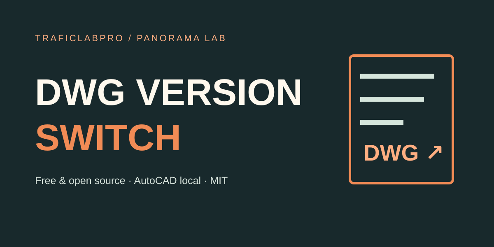

# DWG Version Switch

**Conversor local de versiones AutoCAD + analizador gratuito de encabezados DWG.** Proyecto de código abierto de TraficLabPro / PANORAMA LAB.

[🌐 Probar el analizador](https://trafficlab-panorama.com/dwg-versiones.html) · [⬇ Descargar versión libre](https://trafficlab-panorama.com/downloads/dwg-version-switch-community-v1.0.0.zip) · [📊 Evidencia real anonimizada](docs/QA_REAL_CAD.md) · [English](README.en.md)

**Licencia:** MIT. Puedes usarlo, estudiarlo, modificarlo y distribuirlo, incluso comercialmente, conservando el aviso de licencia. Autodesk/AutoCAD no forman parte del software licenciado.

## ¿Qué problema resuelve?

Recibes un DWG creado con una versión reciente de AutoCAD, pero tu cliente o colega necesita abrirlo en una versión anterior. DWG Version Switch te permite **identificar la familia del formato sin subir tu plano** y, en Windows, **guardar una copia en el formato objetivo** con tu propio AutoCAD instalado.

El programa no altera el original: crea una nueva copia, comprueba el encabezado de destino, intenta reabrirla con AutoCAD y registra hashes SHA-256. Reabrir un archivo no significa que todos sus objetos complejos permanezcan idénticos.

## Dos componentes gratuitos

| Parte | Función | Requisito |
| --- | --- | --- |
| **Analizador web** | Lee únicamente los primeros 6 bytes de DWG, identifica familias y exporta un diagnóstico local JSON. | Navegador moderno; sin cuenta ni subir planos |
| **Conversor Windows** | Guarda versiones antiguas o recientes por lotes, conserva el archivo original, comprueba formato y reapertura. | Windows, PowerShell 5.1, AutoCAD de escritorio **licenciado** con Core Console |

El analizador **no convierte en el navegador** ni proporciona servicio CAD cloud. **No redistribuimos AutoCAD**.

## Cómo instalar y usar

1. Descarga el ZIP desde la [web oficial](https://trafficlab-panorama.com/dwg-versiones.html), o clona este repositorio.
2. En Windows, con AutoCAD instalado legítimamente, abre **INICIAR-CONVERSOR.cmd**. Si descargaste el ZIP, extráelo antes.
3. Selecciona uno o varios archivos DWG y la versión de destino; inicia la conversión.
4. Revisa las copias y el reporte **INFORME_DWG_*.json** en la carpeta DWG_CONVERTIDOS de tu Escritorio.
5. Abre y examina visual/técnicamente el resultado antes de entregarlo en un proyecto de ingeniería.

Ejecución opcional en PowerShell:

~~~powershell
.\Convertir-DWG.ps1 -Headless -InputPaths "C:\MisPlanos\plano.dwg" -Target 2013 -OutputDir "C:\MisPlanos\Convertidos"
~~~

El script NO incluye AutoCAD ni modifica rutas de terceros. Requiere acceso local a **accoreconsole.exe** en la instalación de AutoCAD.

### Formatos disponibles

| Formato DWG | Cabecera | Compatible con AutoCAD |
| --- | --- | --- |
| 2018 | AC1032 | 2018–2027 |
| 2013 | AC1027 | 2013–2017 |
| 2010 | AC1024 | 2010–2012 |
| 2007 | AC1021 | 2007–2009 |
| 2004 | AC1018 | 2004–2006 |
| 2000 | AC1015 | 2000–2002 |
| R14 | AC1014 | R14 |

Que AutoCAD 2027 y 2018 compartan formato no prueba que todos los objetos especializados de un DWG sean compatibles. Consulta la [tabla de Autodesk](https://help.autodesk.com/view/ACADWEB/ENU/?caas=caas%2Fsfdcarticles%2Fsfdcarticles%2FAutoCAD-drawing-file-format.html).

## ¿Se probó con un DWG real?

**Sí, con UN DWG privado real, cuyos datos de ingeniería y titularidad no se publican.** En AutoCAD 2027 se realizaron 7 conversiones reales (incluida una vuelta 2007 → 2018), 8 inventarios nativos CAD y 10 comprobaciones del sitio web leyendo DWG reales.

| Verificación | Resultado |
| --- | --- |
| Convertir, comprobar cabecera y reabrir | **7/7** |
| Inspecciones CAD independientes (original + 7 copias) | **8/8** |
| Entidades enumeradas antes y después | **3.043** en cada copia |
| Conteos por tipo, capa utilizada y presentación | **Sin diferencias** |
| Unidades y límites generales del dibujo | **Sin diferencias** |
| Identificadores de bloques anónimos | **4 renumerados** |
| Pruebas en navegador con dibujos reales | **10/10** |

Las pruebas son **de un solo archivo**, no validan universalidad ni fidelidad geométrica 1:1. Algunos formatos antiguos agregaron APPID y renumeraron bloques anónimos. La metodología y el reporte público sin datos privados están en [QA_REAL_CAD.md](docs/QA_REAL_CAD.md) y [qa-results-public.json](docs/qa-results-public.json).

## Contribuir y mejorar

Este código es **gratis y abierto de verdad** bajo MIT; no es una demo limitada para obligarte a pagar. Puedes colaborar directamente en [GitHub](https://github.com/neokyhurtado-cmd/CONVERT-VERSION-AUTOCAD-2026). Aceptamos Issues, Pull Requests y mejoras reproducibles. Buenas primeras aportaciones: compatibilidad adicional, interfaz de escritorio, pruebas con archivos sintéticos, accesibilidad y alertas por objetos proxy.

Antes de enviar cambios, lee [CONTRIBUTING.md](CONTRIBUTING.md) y [SECURITY.md](SECURITY.md). No subas planos de clientes, rutas privadas, tokens, datos personales ni material sin permiso. Nuestro [roadmap](ROADMAP.md) separa software comunitario de posibles servicios comerciales **todavía no lanzados**.

## ¿Qué significa una futura edición profesional?

La edición comunitaria conserva todos sus derechos MIT. Una oferta empresarial, si se desarrolla, podría sumar integración en flujos CAD de empresas, soporte, automatización gestionada y auditoría profunda de entregables. **No anunciamos esas funciones como disponibles hoy ni cobramos por desbloquear el código MIT.**

## Alternativas y advertencias

[Autodesk DWG TrueView](https://www.autodesk.com/products/dwg-trueview/overview) es gratuito y también convierte formatos DWG; puede ser una opción mejor si no tienes AutoCAD. Nuestro valor es ofrecer una interfaz propia de diagnóstico y un script **inspeccionable y modificable** que usa una instalación local legítima de AutoCAD.

**No hay garantía de preservación 1:1** de geometría, cotas, bloques dinámicos, XREF, objetos AEC/Civil 3D/proxy, fuentes o estilos en formatos antiguos. Una apertura exitosa no es un certificado de ingeniería. Haz respaldo y QA visual y técnico antes de entregar.

© 2026 PANORAMA INGENIERIA · [MIT License](LICENSE) · Ver [NOTICE.md](NOTICE.md) para marcas registradas y dependencias de terceros.
